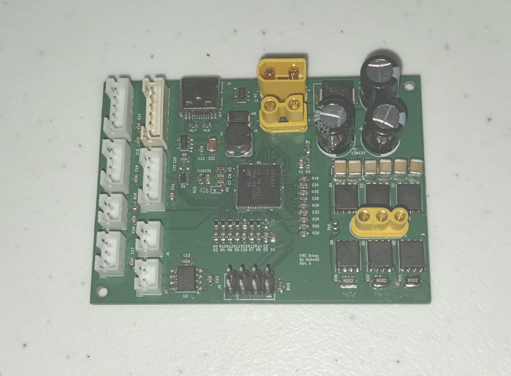

# fluxdrive-g4

Firmware, PC software and hardware design of a field-oriented-control (FOC) driver for 3-phase BLDC/PMSM motors, built as a graduation thesis (TCC) project.



- **Controller:** STSPIN32G4 (STM32G431 Cortex-M4F at 170 MHz with an integrated 3-phase gate driver), six 100 V MOSFETs, three 2 mΩ low-side shunts.
- **Control:** current loop at 25 kHz; speed and position loops at 2.5 kHz. Commutation from an MT6835 21-bit magnetic encoder, from the encoder with a back-EMF flux observer blended in at speed, or sensorless (high-frequency injection at standstill, the observer at speed).
- **Links:** USB-C (virtual COM port: telemetry, configuration, calibration) and CANopen (CiA 301 node, CiA 402 drive profile: PP, PV, HM, CSP, CSV, CST).
- **Protections:** overcurrent, over/undervoltage, regen clamp, overspeed, encoder loss, gate-driver faults. Stops coast instead of short-braking a spinning motor.
- **PC software:** a Python/Qt GUI with live plots, a parameter editor, a calibration wizard and a CANopen master, plus a CANopen test runner.

## Ratings and status

| | Designed for | Tested up to |
|---|---|---|
| Bus voltage | 70 V | 32 V |
| Phase current (continuous) | 15 A | 10 A |

This is a working prototype from a graduation thesis, not a finished product. Everything above the tested values is untested: the bridge MOSFETs are rated 100 V, but thermal performance, layout and protection behaviour at 70 V / 15 A have not been verified. The firmware defaults are conservative: overcurrent trip `imax` = 1.5 A and overvoltage trip `vbus_max` = 60 V; raise them deliberately for your motor and supply.

> [!WARNING]
> **This board switches high currents at voltages that can hurt you and destroy hardware.**
> - Bring up a new board, motor or firmware build from a **current-limited bench supply**, starting at low voltage and with a low `imax`.
> - A misconfigured or uncalibrated drive can **spin the motor suddenly and at full speed**. Clamp the motor and keep hands, cables and loose parts away from anything that rotates.
> - A spinning motor is a generator: it can push the bus voltage up (regeneration) or keep the phases live after the supply is off. Use a supply that tolerates reverse current, or a braking resistor/clamp, and wait for the motor to stop before touching it.
> - The MOSFETs, shunts and motor get hot. Watch the board temperature (Flux Studio shows it) and provide cooling above a few amps.
> - Use it at your own risk; see the licenses below (no warranty).

## Documentation

| Document | For |
|---|---|
| [docs/user-manual-driver.md](docs/user-manual-driver.md) | Using the driver: connections, flashing, commissioning a motor, run modes, protections, CANopen, parameter reference, troubleshooting |
| [docs/user-manual-software.md](docs/user-manual-software.md) | Using the PC software: Flux Studio (Scope, Config, CANopen tabs), test runner, helper scripts |
| [docs/developer-guide.md](docs/developer-guide.md) | Developer guide: build system, CubeMX rules, architecture, execution model, conventions |
| [docs/design-notes.md](docs/design-notes.md) | Design decisions, bench measurements and open items: config protocol, CANopen drive and PC tool, HFI, sensorless tuning, flash budget |
| [docs/software-structure.md](docs/software-structure.md) | Flowcharts of the software: modules, boot, main loop, PWM period, `currentLoop()`, protocol, telemetry, CANopen, trips, flash, PC tools, interrupt priorities |

## Repository layout

| Path | Content |
|---|---|
| `Core/` | Firmware: CubeMX-generated peripheral setup plus the hand-written control code (`motorCtrl.c`, `calib.c`, `hfi.c`, `mt6835.c`, `proto.c`, `objdict.c`, `params.c`, …) |
| `CANopen/` | CANopenNode stack, the FDCAN port, the object dictionary (exported from `fluxdrive-g4.xdd`) and the CiA 402 layer |
| `Drivers/`, `Middlewares/`, `USB_Device/` | ST HAL, CMSIS and USB device stack (generated) |
| `fluxdrive-g4.ioc` | STM32CubeMX project: the source of truth for the peripheral setup |
| `fluxdrive-g4.xdd` | CANopenEditor project of the object dictionary |
| `software/` | PC software: `fluxstudio.py` (GUI), `cotest.py` (CANopen tests), `fluxdrive-g4.eds` (EDS for CANopen masters) |
| `hardware/` | KiCad project of the board: schematic (controller, connections, power sheets) and PCB, the schematic as PDF (`fluxdrive-g4 schematic.pdf`). [hardware/README.md](hardware/README.md) links the datasheets of the main parts |
| `docs/` | Manuals and design notes |

## Quick start

### Firmware
Requirements: arm-none-eabi-gcc, make, OpenOCD and an ST-Link (paths in `.stm32env`). The project is set up for the **STM32 for VSCode** extension.

```
make -f STM32Make.make -j                                   # debug build -> build/debug/fluxdrive-g4.elf
make -f STM32Make.make -j flash                             # flash over ST-Link
make -f STM32Make.make -j DEBUG=0 OPTIMIZATION=-Os flash    # release build
```

A new board needs its option bytes set once before it boots from flash with CAN connected; see the driver manual, section 4.1. After the first flash, updates can also go over USB DFU (Config tab, **Reboot to DFU**, then STM32CubeProgrammer).

### PC software
```
pip install -r software/requirements.txt
python software/fluxstudio.py
```
Connect to the port marked **[driver USB]**, then follow the calibration steps in the Config tab (driver manual, section 5).

### Hardware
Open `hardware/fluxdrive-g4.kicad_pro` in KiCad (made with KiCad 10).

## License

- Firmware and PC software: MIT, see [LICENSE](LICENSE).
- Hardware (`hardware/`): CERN Open Hardware Licence Version 2 - Permissive (CERN-OHL-P-2.0), see [hardware/LICENSE](hardware/LICENSE).
- Third-party components keep their own licenses: CMSIS (Apache-2.0), the STM32G4 HAL (BSD-3-Clause), CANopenNode (Apache-2.0) and the ST USB device library (`Middlewares/ST/STM32_USB_Device_Library`, ST's SLA0044 license).
