# Software structure

This document shows how the firmware and the PC tools fit together, as a set of flowcharts. It covers the paths code runs on (boot, main loop, interrupts), what each module calls and where data crosses from one context to another. The design reasons and bench numbers are in `design-notes.md`; usage is in the two user manuals.

The diagrams are Mermaid. GitHub and VS Code (with a Mermaid preview extension) draw them.

Contents:
1. [System overview](#1-system-overview)
2. [Firmware modules and layers](#2-firmware-modules-and-layers)
3. [Boot sequence](#3-boot-sequence)
4. [Main loop](#4-main-loop)
5. [One PWM period (40 µs)](#5-one-pwm-period-40-s)
6. [currentLoop(), the FOC ISR body](#6-currentloop-the-foc-isr-body)
7. [Angle and speed estimation](#7-angle-and-speed-estimation)
8. [USB config protocol path](#8-usb-config-protocol-path)
9. [Telemetry path](#9-telemetry-path)
10. [CANopen path](#10-canopen-path)
11. [Stops, trips and faults](#11-stops-trips-and-faults)
12. [Parameters in flash](#12-parameters-in-flash)
13. [PC software](#13-pc-software)
14. [Interrupt priorities](#14-interrupt-priorities)

---

## 1. System overview

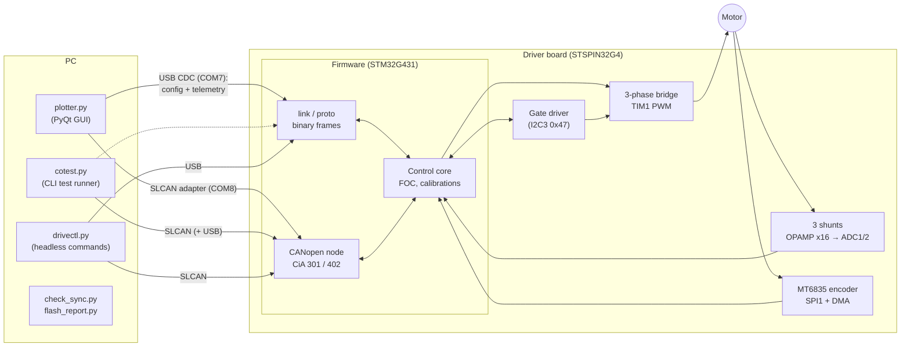

Two ways in:
- **USB CDC**: the binary config protocol (READ/WRITE/LIST of the object table, commands, calibrations) and the 72-byte telemetry frames. USART1 is a build-time fallback (`PROTO_LINK_USB 0`).
- **CANopen on FDCAN1**: normal operation through CiA 402 (PP, PV, HM, CSP, CSV, CST). The same native objects 0x4000–0x40FF are reachable over SDO.

---

## 2. Firmware modules and layers

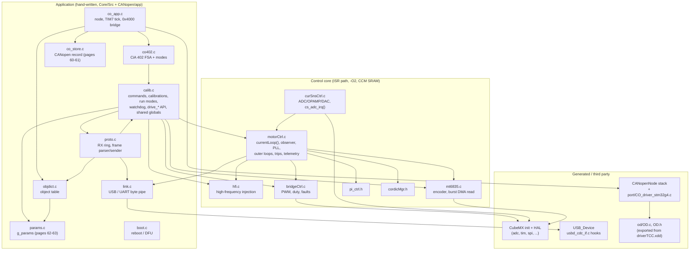

Arrows mean "calls into or uses". `calib.c` owns the globals the ISR reads (`g_mode`, `g_loop`, references, PI states); the ISR never writes `g_mode`.

---

## 3. Boot sequence

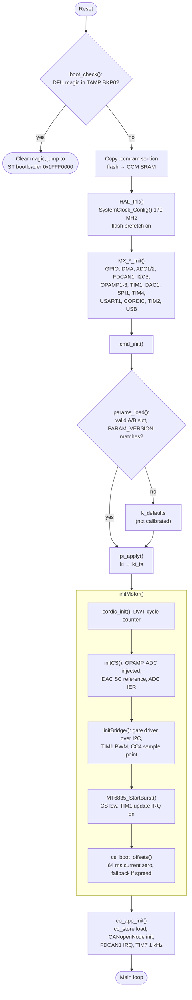

From the end of `initBridge()`, the 25 kHz control interrupt runs. In `CTRL_OFF` it applies zero volts.

---

## 4. Main loop

Everything slow or blocking runs here: commands, calibrations, flash writes, CiA 402 state changes, communication resets.

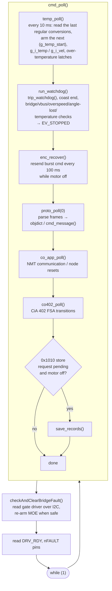

### Blocking commands

A calibration or a speed/position run with a ramp blocks inside `cmd_message()`. It keeps the protocol alive through `chk()`:

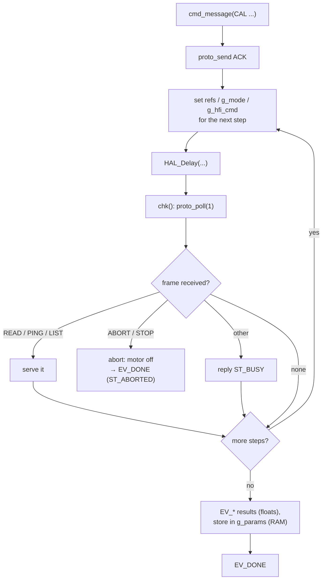

The CANopen tick (TIM7) keeps running while main blocks, so heartbeat and SDO keep working.

---

## 5. One PWM period (40 µs)

TIM1 counts up and down (center-aligned, ARR 3399). The order of events in one period:

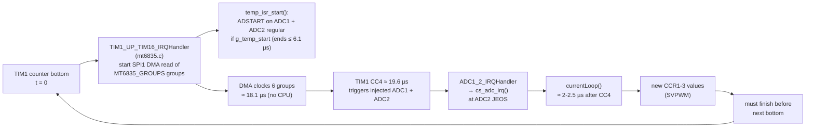

`cs_adc_irq()` reads both ADCs (three phase currents and the bus voltage), subtracts the offsets, scales to amperes and volts, and calls `currentLoop()`.

---

## 6. currentLoop(), the FOC ISR body

```mermaid
flowchart TD
    S(["currentLoop()"]) --> ENC["MT6835_Sample()<br/>last complete group, CRC,<br/>angle + turns, sample age"]
    ENC --> FR{"fresh angle?"}
    FR -- yes --> LZ["g_enc_lost_n = 0"]
    FR -- no --> LI["g_enc_lost_n++"]
    LZ --> MU
    LI --> MU
    MU["motion_update()<br/>encoder PLL: speed;<br/>position from the encoder,<br/>or (ang_src 3/4) last cycle's Hall position"] --> CLK["clarke(ia, ib, ic) → iα, iβ"]
    CLK --> OBS["obs_update()<br/>flux observer (every mode)"]
    OBS --> HE["hfi_estimate()<br/>HFI angle + speed"]
    HE --> HU["hall_update() (flash)<br/>Hall state, interpolated angle + speed"]
    HU --> SRC{"ang_src"}
    SRC -- "0/1 encoder" --> BASE_E["base = encoder angle,<br/>advanced by speed × age"]
    SRC -- "2 sensorless" --> BASE_H["base = HFI angle"]
    SRC -- "3 Hall" --> BASE_L["base = Hall angle"]
    SRC -- "4 Hall + HFI" --> BASE_Y["guard: HFI outside the Hall sector<br/>for 2 ms → hfi_reseed()<br/>base = HFI → Hall by speed<br/>(hyb_lo..hyb_hi)"]
    BASE_L --> HP2["hall_pos_step()<br/>position += Δbase / pp"]
    BASE_Y --> HP2
    BASE_E --> OPLL
    BASE_H --> OPLL
    HP2 --> OPLL
    OPLL["obs_pll()<br/>observer speed"] --> WGT["obs_weight()<br/>blend weight w (0..1)<br/>lock / drop checks"]
    WGT --> VEL["s_vel = blend(base speed, observer speed, w)"]
    VEL --> MODE{"g_mode"}
    MODE -- CTRL_CAL --> TF["θ = g_theta_cmd (forced)"]
    MODE -- "RUN / OFF" --> TB["θm = base + w·(obs − base)<br/>θo = θm + output advance"]
    TF --> SC
    TB --> SC
    SC["sincos_q31(θm), sincos_q31(θo)<br/>(CORDIC)"] --> PARK["park() → id, iq"]
    PARK --> TRIP["trip_check(id, iq)<br/>overvoltage, overcurrent"]
    TRIP --> HS["hfi_step()<br/>injection + demodulation,<br/>hfi_filter(id, iq)"]
    HS --> RC["regen clamp factor rk<br/>(vbus near vbus_max)"]
    RC --> OL["outer_loops()<br/>every OUTER_DIV = 10 cycles:<br/>position P → speed PI → iq_ref<br/>(limit g_i_vel: rated, temperature cap)"]
    OL --> M2{"g_mode"}
    M2 -- CTRL_RUN --> PIC["pi_current_step()<br/>id, iq → vd, vq<br/>(voltage circle, d first)"]
    M2 -- CTRL_CAL --> VC["vd, vq = g_vd_cmd, g_vq_cmd"]
    M2 -- CTRL_OFF --> V0["vd = vq = 0, PI reset"]
    PIC --> IP
    VC --> IP
    V0 --> IP
    IP["ipark(θo) → vα, vβ<br/>+ HFI injection, limit |v| ≤ 1"] --> SVP["SVPWM() → CCR1-3"]
    SVP --> REC["step recorder<br/>(g_rec_state)"]
    REC --> TLM{"10th cycle and<br/>no outer-loop run?"}
    TLM -- yes --> ST["send_telemetry()<br/>fill Frame, link_defer()"]
    TLM -- no --> TM
    ST --> TM["loop time → g_loop_cyc_max"]
    TM --> E(["return"])
```

Notes:
- The outer loops and the telemetry fill never run in the same cycle, which keeps the worst-case loop time down.
- `trip_check()` can force a coast (id = iq = 0) or switch MOE off; see [section 11](#11-stops-trips-and-faults).
- Everything in this chart runs from CCM SRAM except `send_telemetry()` and `hall_update()` (CCM is full).

---

## 7. Angle and speed estimation

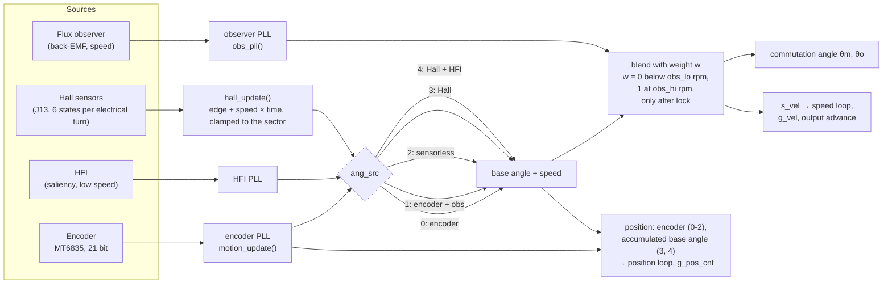

- `ang_src` 0: encoder only (w is computed but forced to 0).
- `ang_src` 1: blends the observer in when `obs_blend` = 1.
- `ang_src` 2: HFI is the base, the observer always blends in above `obs_lo`; the encoder is only logged and position mode is refused.
- `ang_src` 3: the interpolated Hall angle is the base; the observer blends in with `obs_blend` = 1.
- `ang_src` 4: HFI, started on the Hall angle and kept in the Hall sector, crossfades to the Hall angle between `hyb_lo` and `hyb_hi` (the injection pauses above); the observer blends in with `obs_blend` = 1. In 3 and 4 the position is the base angle accumulated.

---

## 8. USB config protocol path

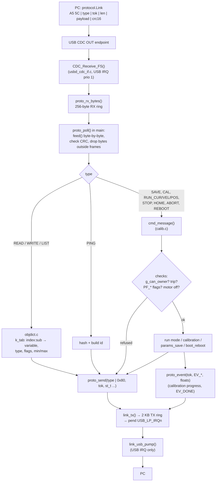

A WRITE takes effect in RAM. SAVE writes flash (both records). With a calibration blocking, the same parser runs with `busy = 1` (see [section 4](#4-main-loop)).

---

## 9. Telemetry path

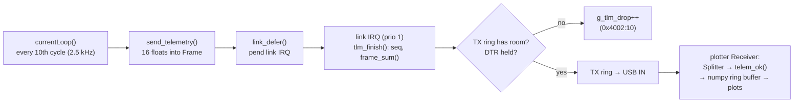

The frame is `A5 5A`, `seq u16`, 16 floats, `sum u32` (72 bytes). The meaning of each `v[i]` is in `PLOTS` in `software/plotter.py`; `check_sync.py` checks it.

---

## 10. CANopen path

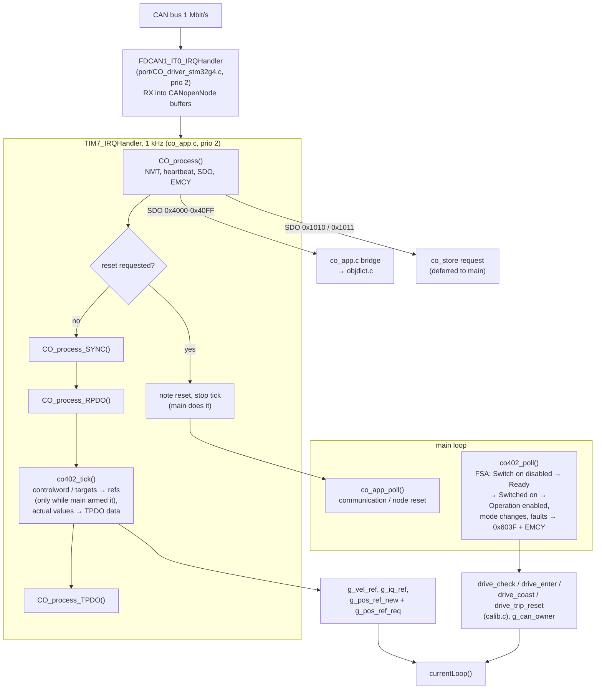

While CANopen owns the drive (`g_can_owner`), USB RUN/CAL/HOME/SAVE/REBOOT are refused with `ST_CAN_ACTIVE`. USB STOP still works; the CANopen side then faults with 0xFF01.

---

## 11. Stops, trips and faults

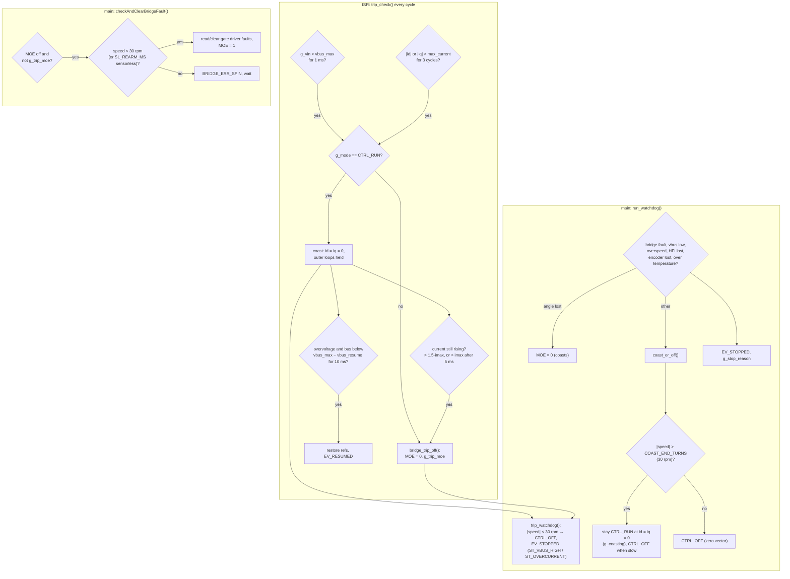

The rule behind most of this chart: never apply the zero vector to a motor spinning above 30 rpm. That would short-brake it at about λ/L, far above `imax`.

---

## 12. Parameters in flash

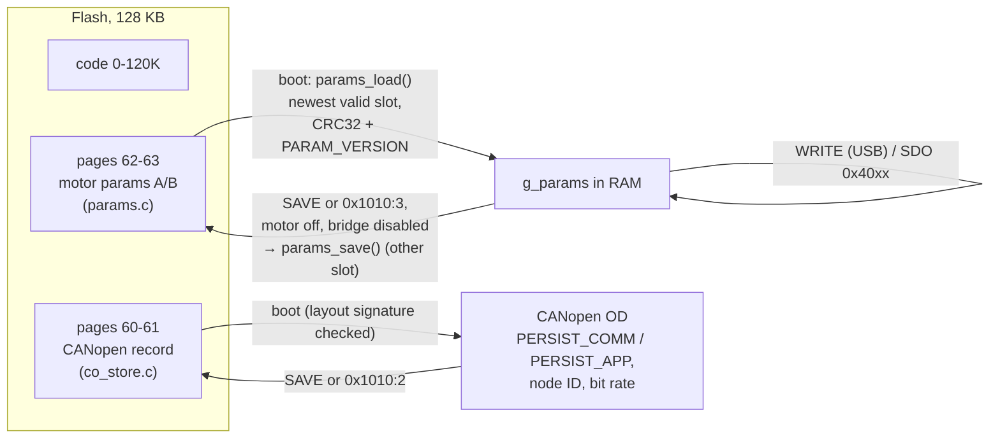

---

## 13. PC software

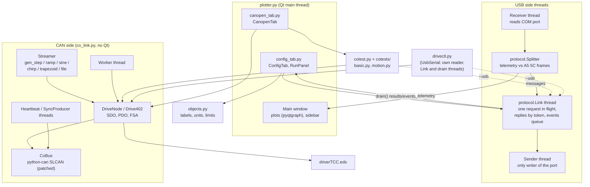

The same test runner works from the command line (`cotest.py`) and from the CANopen tab. `drivectl.py` sends the Config tab's USB commands and basic CANopen master commands without Qt, through the same `Link` (in `co_link.UsbSerial`, whose reader thread also hands telemetry frames to it) and `Drive402`. `check_sync.py` compares the PC tables (`objects.py`, `protocol.py`, `PLOTS`, the EDS) with the firmware sources.

---

## 14. Interrupt priorities

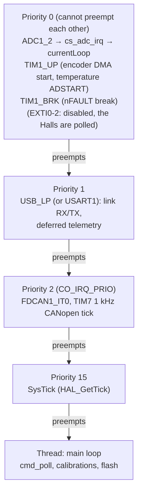

Shared data between levels:
- main → ISR: references first, then mode/loop. 64-bit position through the `g_pos_ref_req` handshake.
- ISR → main: `g_pos_cnt` (atomic int32), filtered values (`g_vq_f`, `g_iq_f`), counters.
- Link IRQ ↔ main: single-producer/single-consumer rings; the TX ring head is written only with priority ≥ 1 masked (BASEPRI).
- CANopen locks mask priority ≥ 2 only, never the control ISR.
